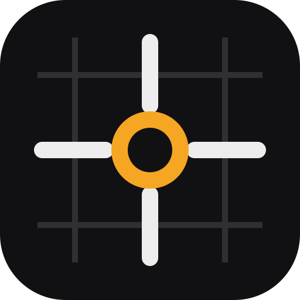
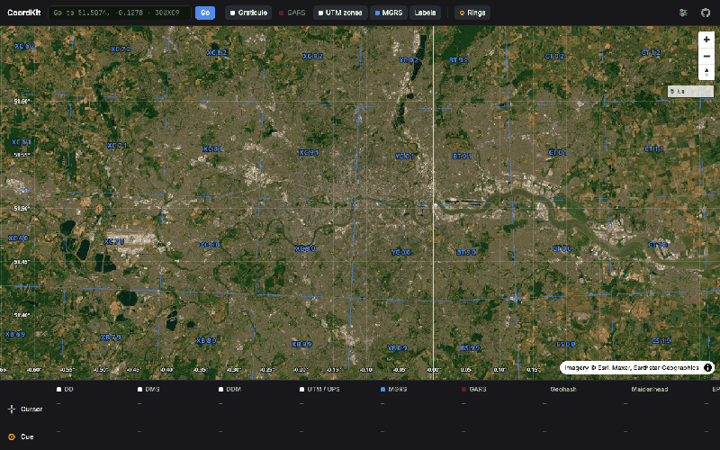
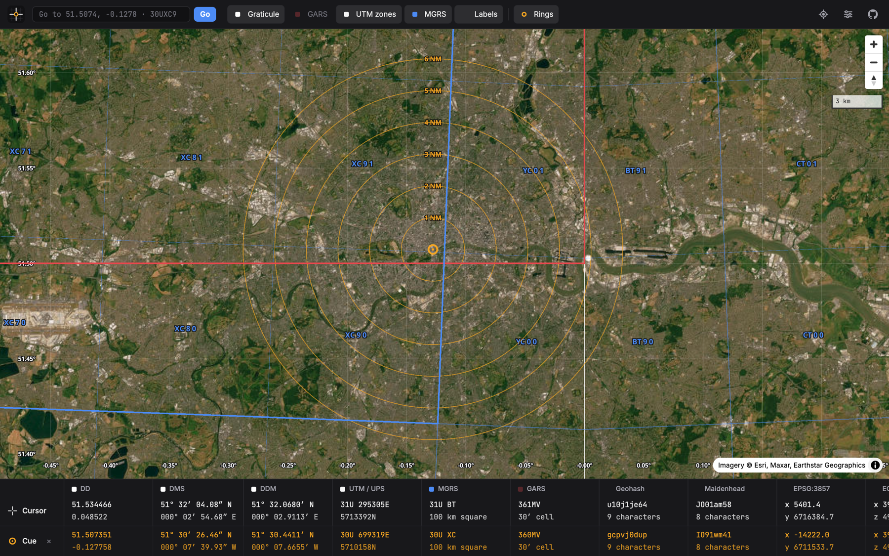
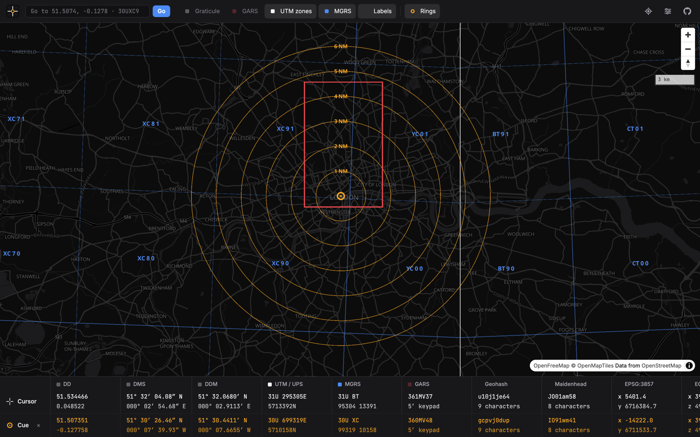
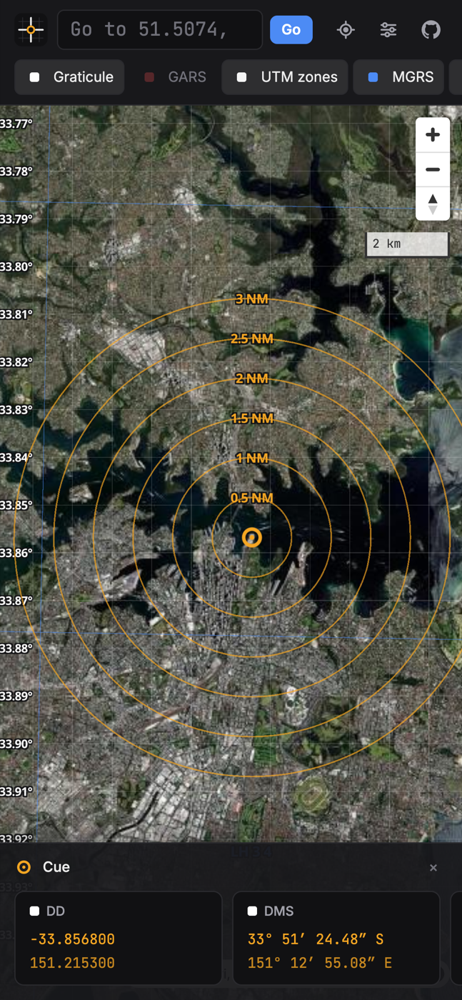
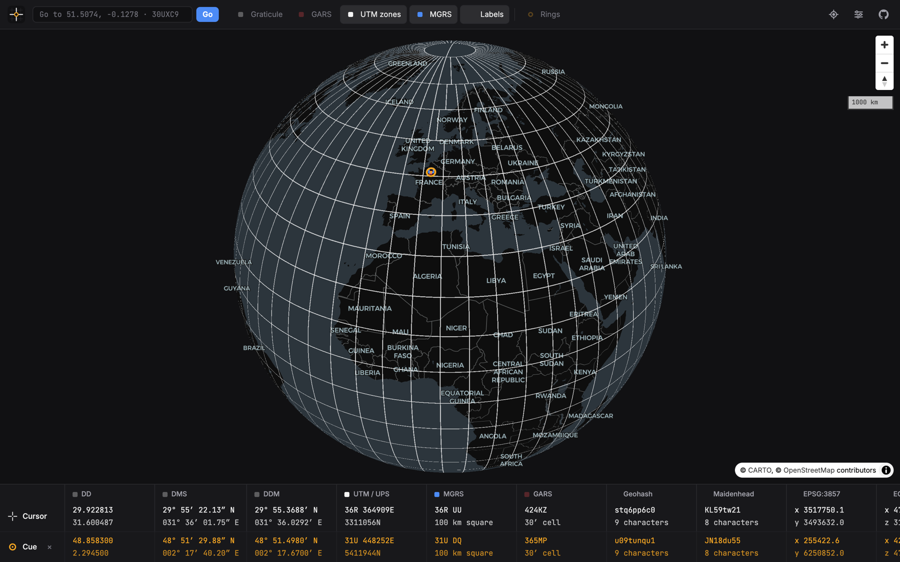
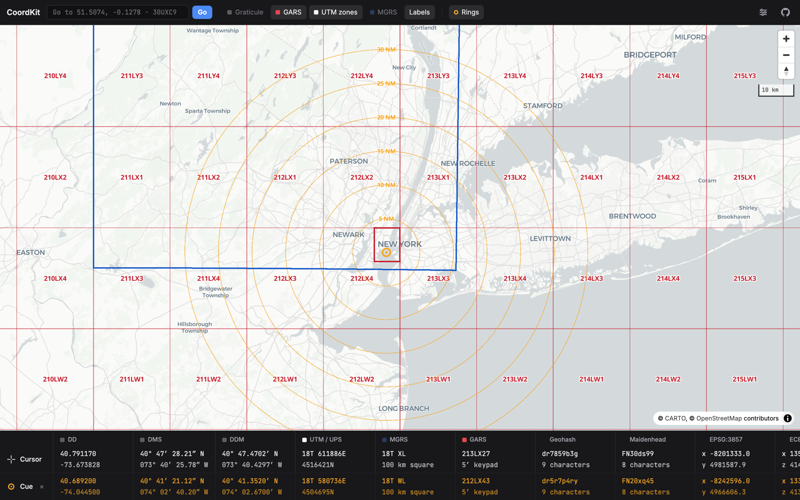

<div align="center">



# CoordKit

**Compare a WGS84 position in ten coordinate systems, on a live map.**

[](https://github.com/eknowles/coordkit/actions/workflows/pages.yml)
[](https://eknowles.github.io/coordkit/coverage/)
[](https://www.typescriptlang.org/)
[](https://foldkit.dev)
[](https://maplibre.org/)
[](#install-and-offline-use)

[**Open the app**](https://eknowles.github.io/coordkit/) · [Coverage report](https://eknowles.github.io/coordkit/coverage/) · [Add a coordinate system](#add-a-coordinate-system)



</div>

## What CoordKit does

- **Cursor and cue.** Move the cross-shaped cursor over the map, and every system shows the cursor position. Click the map to set the cue. The cue stays in place, so you can compare the two positions.
- **Copy.** Click a value in the readout to copy it.
- **Phones.** The readout is a sheet of cards at the bottom of the map. Swipe left and right to see each system. The sheet opens when you set the cue, and closes when you clear it.
- **Grids.** The map can draw UTM zones, the MGRS grid, GARS cells and a latitude and longitude graticule. The grid spacing changes with the zoom level.
- **Search.** Type a coordinate in any supported format. The map moves to it and sets the cue.
- **Find my location.** The location button asks the browser for your position, then sets the cue there.
- **Plus Codes.** CoordKit reads full codes only, because a short code such as `GV4C+WV` needs a reference location. Codes match Google's reference implementation.
- **Web map tiles.** The readout gives the tile at the zoom level that you set in **Map settings > Precision > Map tile**. The map grid shows the tiles one level deeper than the map zoom.
- **Range rings.** The map draws six rings around the cue, in nautical miles or kilometres. Use the **Rings** button to show or hide them.
- **Base maps.** Satellite imagery, a dark map or a light map. Grid colours and label halos change to suit each one.
- **Web Mercator or globe.** Web Mercator shows what most web maps show. The globe shows grids without distortion.
- **Map settings.** The settings button in the toolbar opens the base map, projection, precision and range ring settings.
- **Defaults.** CoordKit starts on satellite imagery in Web Mercator, with UTM zones, the MGRS grid, the graticule, labels and range rings. MGRS shows 100 kilometre squares and GARS shows 30′ cells. The browser keeps your changes.
- **Install and offline use.** Install CoordKit as an app. After the first visit, it works without a network.
- **Share.** The URL holds the map view and the cue.

## Coordinate systems

| System                                     | Readout | Search | Map grid  | Example                                | Reference                                                                                  |
| ------------------------------------------ | :-----: | :----: | :-------: | -------------------------------------- | ------------------------------------------------------------------------------------------ |
| Decimal degrees (DD)                       |    ✓    |   ✓    | graticule | `51.507351, -0.127758`                 | [Wikipedia](https://en.wikipedia.org/wiki/Decimal_degrees)                                 |
| Degrees, minutes, seconds (DMS)            |    ✓    |   ✓    | graticule | `51° 30′ 26.46″ N, 000° 07′ 39.93″ W`  | [Wikipedia](https://en.wikipedia.org/wiki/Geographic_coordinate_system)                    |
| Degrees, decimal minutes (DDM)             |    ✓    |   ✓    | graticule | `51° 30.4411′ N, 000° 07.6655′ W`      | [Wikipedia](https://en.wikipedia.org/wiki/Geographic_coordinate_system)                    |
| Universal Transverse Mercator (UTM)        |    ✓    |   ✓    |   zones   | `30U 699319E 5710158N`                 | [Wikipedia](https://en.wikipedia.org/wiki/Universal_Transverse_Mercator_coordinate_system) |
| Universal Polar Stereographic (UPS)        |    ✓    |   ✓    |   zones   | `UPS N 2000000E 2000000N`              | [Wikipedia](https://en.wikipedia.org/wiki/Universal_polar_stereographic_coordinate_system) |
| Military Grid Reference System (MGRS)      |    ✓    |   ✓    |     ✓     | `30U XC 99319 10158`                   | [Wikipedia](https://en.wikipedia.org/wiki/Military_Grid_Reference_System)                  |
| Global Area Reference System (GARS)        |    ✓    |   ✓    |     ✓     | `360MV48`                              | [Wikipedia](https://en.wikipedia.org/wiki/Global_Area_Reference_System)                    |
| World Geographic Reference System (GEOREF) |    ✓    |   ✓    |     ✓     | `MKQG5230`                             | [Wikipedia](https://en.wikipedia.org/wiki/World_Geographic_Reference_System)               |
| Plus Codes (Open Location Code)            |    ✓    |   ✓    |     ✓     | `9C3XGV4C+WV`                          | [Wikipedia](https://en.wikipedia.org/wiki/Open_Location_Code)                              |
| Geohash                                    |    ✓    |   ✓    |           | `gcpvj0duq`                            | [Wikipedia](https://en.wikipedia.org/wiki/Geohash)                                         |
| Maidenhead Locator System                  |    ✓    |   ✓    |           | `IO91wm41`                             | [Wikipedia](https://en.wikipedia.org/wiki/Maidenhead_Locator_System)                       |
| Web map tiles (XYZ and quadkey)            |    ✓    |   ✓    |     ✓     | `12/2046/1362`, quadkey `031313131130` | [OpenStreetMap wiki](https://wiki.openstreetmap.org/wiki/Slippy_map_tilenames)             |
| Web Mercator (EPSG:3857)                   |    ✓    |        |           | `-14221.99, 6711533.69`                | [Wikipedia](https://en.wikipedia.org/wiki/Web_Mercator_projection)                         |
| Earth-centred, Earth-fixed (ECEF)          |    ✓    |        |           | `3977998.56, -8870.17, 4968871.54`     | [Wikipedia](https://en.wikipedia.org/wiki/Earth-centered,_Earth-fixed_coordinate_system)   |

All positions use the [WGS84](https://en.wikipedia.org/wiki/World_Geodetic_System) datum.

- **UTM and UPS.** The UTM conversion uses the Krüger series. It agrees with [proj4js](https://github.com/proj4js/proj4js) to the millimetre. The Norway and Svalbard zone exceptions apply.
- **MGRS.** CoordKit truncates references and does not round them, as NGA TM 8358.1 specifies. The UTM latitude letter is the MGRS latitude band, not a hemisphere letter.
- **Range rings.** The rings are geodesic circles on WGS84, calculated with [Vincenty's formulae](https://en.wikipedia.org/wiki/Vincenty%27s_formulae). One [nautical mile](https://en.wikipedia.org/wiki/Nautical_mile) is 1852 metres. **Auto** spacing uses a 1, 2, 5 sequence, as a radar range scale does.

### Accepted search formats

| Format     | Example input                                                 |
| ---------- | ------------------------------------------------------------- |
| DD         | `51.5074, -0.1278` or `51.5074 -0.1278` or `51.5074N 0.1278W` |
| DMS        | `51°30'26.5"N 0°07'40"W`                                      |
| DDM        | `51 30.441 N, 0 7.666 W`                                      |
| UTM        | `30U 699319 5710158`                                          |
| UPS        | `UPS N 2000000 2000000`                                       |
| MGRS       | `30UXC9931910158` or `30U XC 993 101`                         |
| GARS       | `361HN37`                                                     |
| Maidenhead | `IO91wm`                                                      |
| GEOREF     | `MKQG5230` or `MKQG`                                          |
| Plus Code  | `9C3XGV4C+WV` or `9C3XGV00+`                                  |
| Map tile   | `12/2046/1362` or `qk:031313131130`                           |
| Geohash    | `gcpvj0duq` or `gh:u4pr`                                      |

## Screenshots

<table>
  <tr>
    <td width="39%"></td>
    <td width="39%"></td>
    <td width="22%" rowspan="4"></td>
  </tr>
  <tr>
    <td align="center"><sub>Satellite imagery (default)</sub></td>
    <td align="center"><sub>Dark map with the MGRS grid</sub></td>
  </tr>
  <tr>
    <td></td>
    <td></td>
  </tr>
  <tr>
    <td align="center"><sub>Globe with UTM zones</sub></td>
    <td align="center"><sub>Light map with GARS cells</sub></td>
  </tr>
</table>

## Built with

|                                                                                    | Tool                                                                                                                                       | Use                                                                                             |
| ---------------------------------------------------------------------------------- | ------------------------------------------------------------------------------------------------------------------------------------------ | ----------------------------------------------------------------------------------------------- |
|                     | [Foldkit](https://foldkit.dev)                                                                                                             | The Elm Architecture in TypeScript: one Model, an `update` function, Commands and Subscriptions |
|                  | [Effect](https://effect.website)                                                                                                           | Schemas for the Model and Messages, and the effects in Commands                                 |
|                    | [MapLibre GL JS](https://maplibre.org)                                                                                                     | The map, the globe projection, and the grid lines and labels                                    |
|                           | [Vite](https://vite.dev)                                                                                                                   | The development server and the build                                                            |
|                             | [Bun](https://bun.sh)                                                                                                                      | Packages and scripts                                                                            |
|                         | [Vitest](https://vitest.dev)                                                                                                               | Unit, story and scene tests, and coverage                                                       |
|  | [Tailwind CSS](https://tailwindcss.com)                                                                                                    | Styles                                                                                          |
|        | [Vite PWA](https://vite-pwa-org.netlify.app)                                                                                               | The web app manifest and the Workbox service worker                                             |
|                  | [Devbox](https://www.jetify.com/devbox) and [just](https://just.systems)                                                                   | A repeatable toolchain and the project commands                                                 |
|                                                                                    | [Inter](https://rsms.me/inter/) and [JetBrains Mono](https://www.jetbrains.com/lp/mono/)                                                   | Interface text and coordinate values                                                            |
|                                                                                    | [OpenFreeMap](https://openfreemap.org) and [Esri World Imagery](https://www.arcgis.com/home/item.html?id=10df2279f9684e4a9f6a7f08febac2a9) | The dark, light and satellite base maps                                                         |

The tests use [proj4js](https://github.com/proj4js/proj4js) and the [mgrs](https://github.com/proj4js/mgrs) package as reference implementations. The application does not include them.

## Tests and coverage

[](https://eknowles.github.io/coordkit/coverage/)

The tests are in three groups:

- **Unit tests** for each coordinate system. They compare the results with proj4js, the mgrs package and published reference values.
- **Story tests** for `update`. They send Messages and check the Model and the Commands.
- **Scene tests** for the view. They find controls by their accessible names and click them, as a user does.

Each deploy runs the tests with coverage. The deploy publishes the badge above and the [full coverage report](https://eknowles.github.io/coordkit/coverage/). The build fails if coverage falls below these values:

| Lines | Statements | Functions | Branches |
| ----- | ---------- | --------- | -------- |
| 93%   | 92%        | 85%       | 84%      |

To see the report on your computer, run `just coverage`, then open `coverage/index.html`.

## Install and offline use

CoordKit is a progressive web app (PWA). Install it from the browser, for example with **Install app** in Chrome or **Add to Home Screen** in Safari on iOS.

After the first visit, CoordKit works offline:

- The service worker stores the application code, styles, icons and fonts when it installs.
- The service worker stores map styles and map tiles when you look at them, for up to 30 days. Offline, you can see the areas and zoom levels that you looked at before.
- All coordinate conversions, grids and range rings work without a network.
- When you deploy a new version, the application updates itself the next time a user opens it.

The tile caches have a size limit: 4000 vector tiles and 2000 satellite tiles. The browser removes the oldest tiles first.

## Get started

You need [Devbox](https://www.jetify.com/devbox). Devbox installs Bun, just and Node.js. You can also use Bun 1.4, just and Node.js 22.22.2 or later without Devbox.

1. Start a Devbox shell. The shell installs the dependencies.

   ```sh
   devbox shell
   ```

2. Start the development server.

   ```sh
   just dev
   ```

3. Open <http://localhost:5180> in a browser.

The development server also shows the Foldkit DevTools panel. Use it to see the Model and the Message history.

### Commands

| Command            | Description                                                                                                                              |
| ------------------ | ---------------------------------------------------------------------------------------------------------------------------------------- |
| `just dev`         | Starts the Vite development server on port 5180.                                                                                         |
| `just test`        | Runs the tests.                                                                                                                          |
| `just coverage`    | Runs the tests with a coverage report.                                                                                                   |
| `just typecheck`   | Runs the TypeScript compiler without output.                                                                                             |
| `just lint`        | Runs oxlint with the Foldkit rules.                                                                                                      |
| `just format`      | Formats the sources with oxfmt.                                                                                                          |
| `just check`       | Checks the format, runs the linter and the type check, and runs the tests with coverage.                                                 |
| `just build`       | Builds the static site into `dist/`.                                                                                                     |
| `just preview`     | Builds the site and serves `dist/` on port 4173. Use it to test the service worker, because the development server does not register it. |
| `just icons`       | Makes the favicons and app icons from `public/logo.svg`. Needs `rsvg-convert`.                                                           |
| `just screenshots` | Captures the README screenshots from the preview server. Needs Google Chrome.                                                            |
| `just demo`        | Records the README demo GIF from the preview server. Needs Google Chrome.                                                                |

To run a command without a Devbox shell, use `devbox run -- just <recipe>`.

## Architecture

Each folder in `src/` holds one kind of code.

| Folder           | Kind                | Contents                                                                                                                                                                                                                                 |
| ---------------- | ------------------- | ---------------------------------------------------------------------------------------------------------------------------------------------------------------------------------------------------------------------------------------- |
| `src/app/`       | Foldkit program     | The root: Model, Messages, Flags, Subscriptions, `init`, `update`, the URL Command and the root view.                                                                                                                                    |
| `src/submodels/` | Submodels           | `settings/` for the map settings, `goTo/` for search and "Find my location", and `copy/` for the copy feedback in the readout.                                                                                                           |
| `src/views/`     | Views without state | `toolbar/` above the map, `readout/` (a table on wide screens and a sheet of cards on phones), and `ui/` (icons, the select control, the overlay switch and grid colour swatches).                                                       |
| `src/map/`       | Map adapter         | The `<coordkit-map>` custom element, grid overlays, grid labels, the cue marker and range rings. The view sets the element's properties from the Model, so the map always matches the Model, also in DevTools time travel.               |
| `src/core/`      | Plain TypeScript    | `systems/` (one folder for each coordinate system, the capability interfaces and the registry), `geo/` (ellipsoid constants, shared geometry and the WGS84 geodesic) and `domain/` (Schemas that more than one module uses). No Foldkit. |

For a description of how the Foldkit parts work together, see [How CoordKit uses Foldkit](docs/foldkit-architecture.md).

Each coordinate system can supply three capabilities:

- A formatter, which gives the readout column.
- A parser, which reads the system in the search box.
- A grid, which draws the system on the map and outlines the cue cell.

The registry in `src/core/systems/registry.ts` lists all of them. The rest of the application reads the registry and does not refer to a system by name.

### Add a coordinate system

1. Create a folder in `src/core/systems/`. Put the conversion code and its tests in the folder.
2. In the folder, add an `index.ts` file. Export a formatter, a parser or a grid, as the system supports.
3. Add each export to the correct list in `src/core/systems/registry.ts`.

## Deploy to GitHub Pages

The workflow `.github/workflows/pages.yml` tests, builds and deploys the site on each push to `main`.

1. Push the repository to GitHub.
2. In the repository, go to **Settings > Pages**.
3. In **Build and deployment > Source**, select **GitHub Actions**.
4. Push to `main`.

The build uses relative asset paths. The site works at a project URL, for example `https://<user>.github.io/coordkit/`.
