# How CoordKit uses Foldkit

Read this document to learn how the CoordKit application uses Foldkit. It shows
how data moves through the application, and which file does each task.

For the Foldkit API and conventions, read [`FOLDKIT.md`](../FOLDKIT.md). For
the folder layout and import rules, read [`AGENTS.md`](../AGENTS.md).

## Overview

Foldkit is a frontend framework that uses the Elm Architecture. It uses
[Effect](https://effect.website) as its base. An application has these parts:

| Part             | What it is                                                             | CoordKit file             |
| ---------------- | ---------------------------------------------------------------------- | ------------------------- |
| **Flags**        | Data that the application reads one time, before it starts             | `src/app/flags.ts`        |
| **Model**        | One immutable value that holds all of the application state            | `src/app/model.ts`        |
| **Message**      | A fact about an event that occurred, for example `ClickedMap`          | `src/app/message.ts`      |
| **init**         | A function that makes the first Model from the Flags                   | `src/app/init.ts`         |
| **update**       | A pure function. It takes a Model and a Message, and gives a new Model | `src/app/update.ts`       |
| **Command**      | A side effect that `update` asks for. The runtime runs it              | `src/app/command.ts`      |
| **Subscription** | A stream of Messages from the browser, for example a media query       | `src/app/subscription.ts` |
| **view**         | A pure function. It takes the Model and gives the HTML tree            | `src/app/view.ts`         |
| **Submodel**     | A smaller Model, Message, update and view that the root Model contains | `src/submodels/`          |

`src/app/entry.ts` connects these parts with `Runtime.makeApplication` and starts
the application with `Runtime.run`.

The application code does not change state directly. It does not call the
browser directly from `update` or `view`. Only the runtime changes the Model,
runs Commands and changes the page.

## Folders

Each folder in `src/` holds one kind of code. Use the folder to find out what
a file is.

| Folder           | Kind                | Uses Foldkit                                 |
| ---------------- | ------------------- | -------------------------------------------- |
| `src/app/`       | The Foldkit program | Yes                                          |
| `src/submodels/` | Submodels           | Yes                                          |
| `src/views/`     | Views without state | Yes, the HTML builder only                   |
| `src/map/`       | The map adapter     | Only `view.ts` and `cameraRequest.ts`        |
| `src/core/`      | Plain TypeScript    | No. The lint check stops all Foldkit imports |
| `src/test/`      | Test support        | Yes                                          |

A folder in `src/submodels/` has state. It has `model.ts`, `message.ts`,
`update.ts` and `view.ts`. A folder in `src/views/` has no state. It has view
functions only, and it reads the root Model.

Code outside `src/app/` imports the root with the `@/` alias, for example
`import { Message } from '@/message'`. The Foldkit lint plugin uses this path
to identify the root Message. Do not change it to a relative path such as
`../../app/message`.

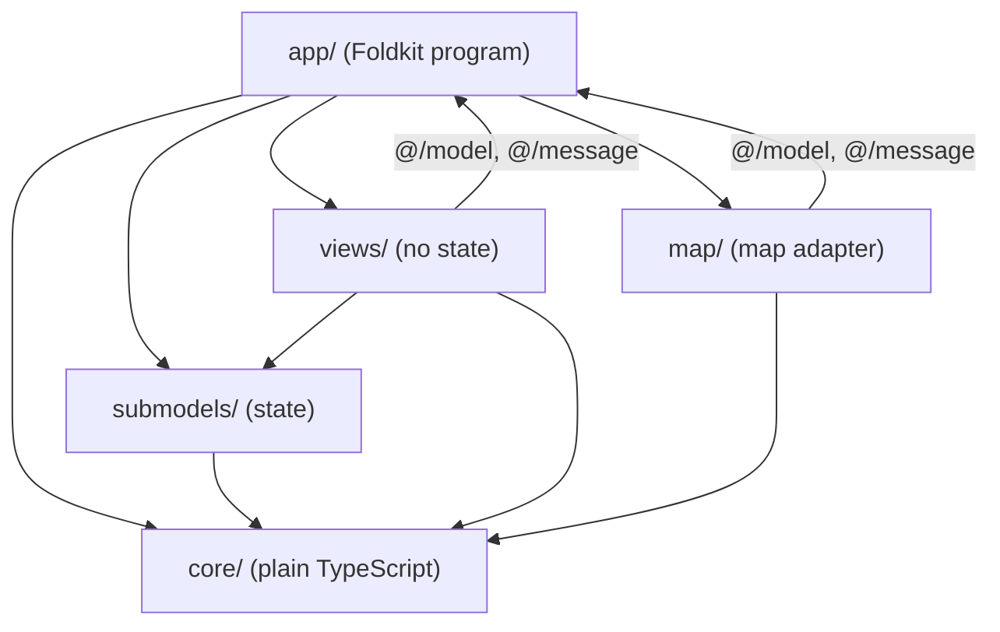

The arrows show which folder can import from which folder. Nothing points out
of `core/`.

## The update loop

The diagram shows one cycle of the loop. Each cycle starts with one Message.

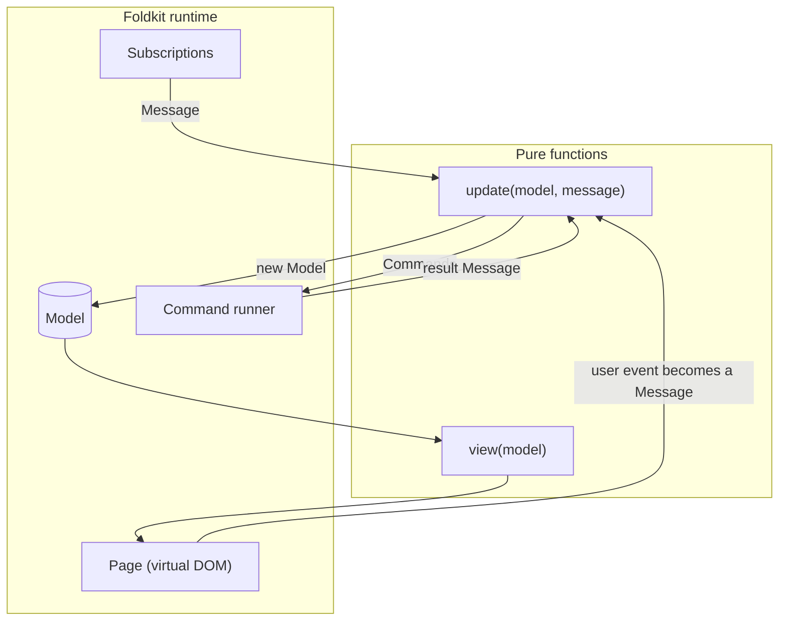

1. An event occurs. For example, the user clicks the map.
2. The view has a handler for that event. The handler makes a Message.
3. The runtime gives the Model and the Message to `update`.
4. `update` gives a new Model and, if necessary, a list of Commands.
5. The runtime keeps the new Model and calls `view` again. It changes only the
   parts of the page that are different.
6. The runtime runs each Command. Each Command gives one result Message, which
   starts a new cycle.

## Start of the application

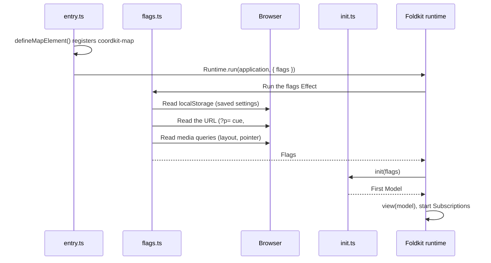

`src/app/flags.ts` is an Effect. It reads:

- The saved settings from `localStorage`. If the settings are missing, cannot
  be read, or have an old shape, the result is `Option.none()`. `init` then
  uses the default settings.
- The cue from the `?p=` query parameter, as text.
- The camera from the `#view=zoom/lat/lon/bearing/pitch` hash.
- The layout (`Wide` or `Compact`) and the pointer (`Fine` or `Touch`) from
  media queries.

`src/app/init.ts` makes the first Model. It parses the cue text with the same
parsers that the search field uses, so a shared link can contain any format
that search accepts. `init` gives no Commands.

## The Model

`src/app/model.ts` declares the Model as an Effect `Schema.Struct`. Because the
Model is a Schema, DevTools can show it, and tests can compare it.

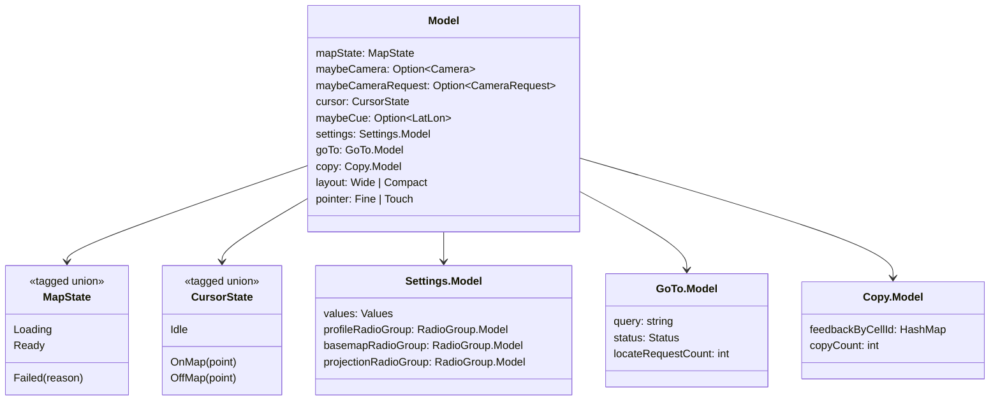

The Model uses tagged unions, not Boolean flags, for state that has more than
two forms. For example, `CursorState.OffMap` keeps the last point, so the
readout can show it in grey after the cursor leaves the map.

## Messages

`src/app/message.ts` declares each Message with `defineMessageUnion`. Each name
tells what occurred, in the past tense. It does not tell what to do.

| Message                                   | Source                   |
| ----------------------------------------- | ------------------------ |
| `LoadedMap`, `FailedLoadMap`              | The map element          |
| `MovedMap`, `MovedCursor`, `LeftMap`      | The map element          |
| `ClickedMap`                              | The map element          |
| `ClickedClearCue`                         | The readout              |
| `UpdatedLayout`, `UpdatedPointer`         | Subscriptions            |
| `SucceededReplaceUrl`, `FailedReplaceUrl` | The `ReplaceUrl` Command |
| `GotSettingsMessage`                      | The Settings Submodel    |
| `GotGoToMessage`                          | The GoTo Submodel        |
| `GotCopyMessage`                          | The Copy Submodel        |

The three `Got…Message` Messages wrap a Submodel Message. The root `update`
sends the wrapped Message to the correct Submodel.

## Update, Steps and Commands

`src/app/update.ts` uses `Message.match` to select one handler for each Message.
Some handlers change one field. Others join small **Steps** with
`Update.combine`. A Step is a function from a Model to a new Model and
Commands. `Update.combine` runs the Steps in order and collects all of the
Commands.

For example, `ClickedMap` joins three Steps:

```ts
ClickedMap: ({ point }) =>
  Update.combine(model, [
    setCue(Option.some(point)),
    clearGoToStatus,
    replaceUrl,
  ]),
```

`replaceUrl` is the last Step, because it reads the cue and the camera from the
Model that the earlier Steps made.

### Commands

You declare a Command with `Command.define`. A Command has a name, arguments, the
Messages that it can give, and an `execute` Effect. `update` only returns the
Command. The runtime runs it.

| Command                        | File                               | What it does                                                   | Result Messages                                           |
| ------------------------------ | ---------------------------------- | -------------------------------------------------------------- | --------------------------------------------------------- |
| `ReplaceUrl`                   | `src/app/command.ts`               | Writes the cue and the camera into the URL with `replaceState` | `SucceededReplaceUrl`, `FailedReplaceUrl`                 |
| `SaveSettings`                 | `src/submodels/settings/update.ts` | Writes the settings to `localStorage`                          | `SucceededSaveSettings`, `FailedSaveSettings`             |
| `GetCurrentPosition`           | `src/submodels/goTo/update.ts`     | Asks the browser for the device position                       | `SucceededGetCurrentPosition`, `FailedGetCurrentPosition` |
| `CopyText`                     | `src/submodels/copy/update.ts`     | Writes a reading to the clipboard                              | `SucceededCopyText`, `FailedCopyText`                     |
| `WaitBeforeHidingCopyFeedback` | `src/submodels/copy/update.ts`     | Waits, then tells the Copy Submodel to hide "Copied"           | `CompletedWaitBeforeHidingCopyFeedback`                   |

Each Command catches its errors and changes them into a failure Message with
`Effect.catch`. Thus, a Command never fails the runtime.

## Subscriptions

`src/app/subscription.ts` declares two Subscriptions. Each one changes a media
query into a stream of Messages:

- `layout` sends `UpdatedLayout` when the window becomes narrower or wider
  than 768 px.
- `pointer` sends `UpdatedPointer` when the device can or cannot hover.

Both are `persistentEntry` Subscriptions. They start one time and do not
depend on the Model.

## The view

`src/app/view.ts` gives the page as a tree of `h.*` calls. The view reads only the
Model. Event handlers in the view give Messages. They do not run code.

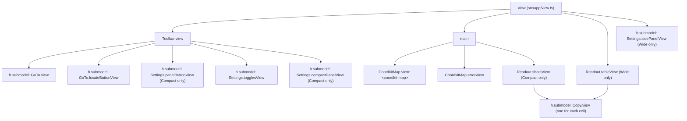

`model.layout` selects the readout and the settings. A `Wide` layout shows the
table below the map, and the settings in a column beside the map. A `Compact`
layout shows a sheet over the map, and the settings in a strip below the
toolbar. The settings button opens and closes the strip.

## Submodels

CoordKit has three Submodels. Each one is a folder with `model.ts`,
`message.ts`, `update.ts`, `view.ts` and an `index.ts` barrel.

| Submodel | Folder                    | Responsibility                                                             |
| -------- | ------------------------- | -------------------------------------------------------------------------- |
| Settings | `src/submodels/settings/` | Profile, grid toggles, base map, projection, precisions and range rings. Saves them |
| GoTo     | `src/submodels/goTo/`     | The search field, "Find my location", and the status line for both         |
| Copy     | `src/submodels/copy/`     | Copies a readout cell to the clipboard and shows "Copied" or "Copy failed" |

A Submodel does not know about the root Model. The root connects each
Submodel in two places.

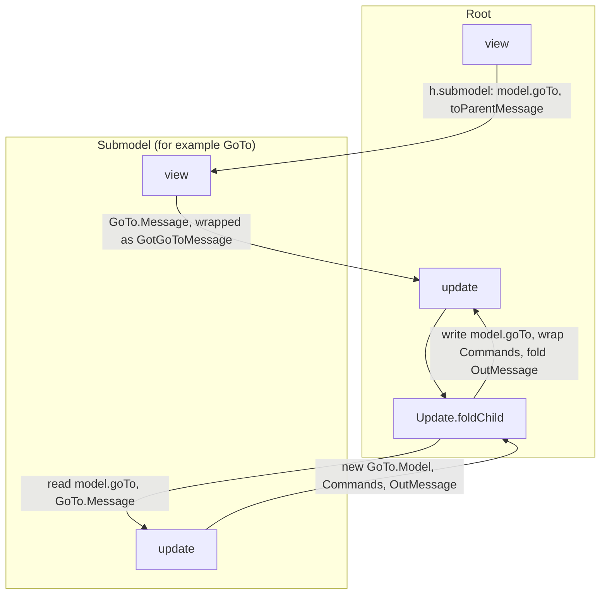

- **In the view**, `h.submodel` renders the Submodel view with its part of the
  Model. Its `toParentMessage` wraps each Submodel Message in a root Message,
  for example `GotGoToMessage`.
- **In `update`**, `Update.foldChild` reads the Submodel Model, runs the
  Submodel `update`, writes the result back, and wraps the Submodel Commands.

The Settings Submodel contains three `RadioGroup` Submodels from `@foldkit/ui`,
for the profile, the base map and the projection. It connects them with the
same pattern. The strip on compact screens uses the `Disclosure` view from
`@foldkit/ui`. The open state is in the saved settings (`isPanelOpen`).

### OutMessages

Sometimes a Submodel must tell the root that something occurred. The GoTo
Submodel does this with an **OutMessage**. When a search or a location request
is successful, GoTo gives the `ChoseLocation` OutMessage. The root then:

1. Sets the cue.
2. Asks the map for an animated move (a `CameraRequest`).
3. Writes the URL.

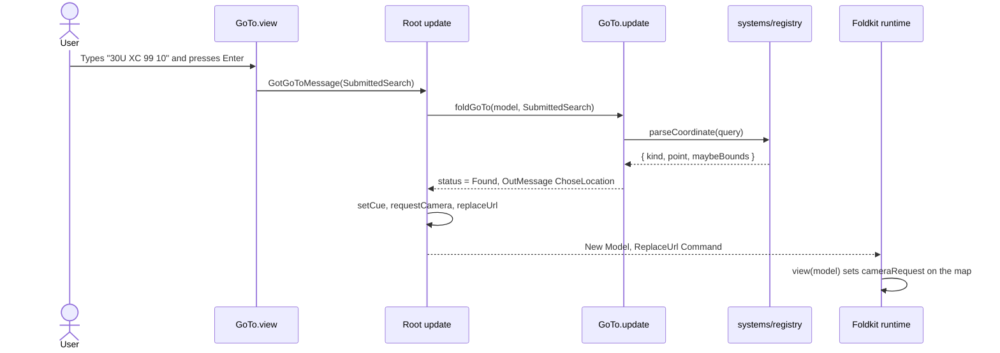

### Request IDs

GoTo and Copy use an increasing ID to discard results that are out of date:

- Each location request gets the next `requestId`. A result counts only if its
  ID agrees with the request in `Status.Locating`. If the user types or
  searches during the request, a late answer has no effect.
- Each copy gets the next `copyId`. A wait that completes removes the feedback
  only if no newer copy of the same cell occurred.

## The map element

MapLibre keeps its own state and changes the page itself. Foldkit cannot
render it as a normal view. Thus, CoordKit puts MapLibre inside a custom
element, `<coordkit-map>`. The element is a function of the Model: properties
go in, and events come out.

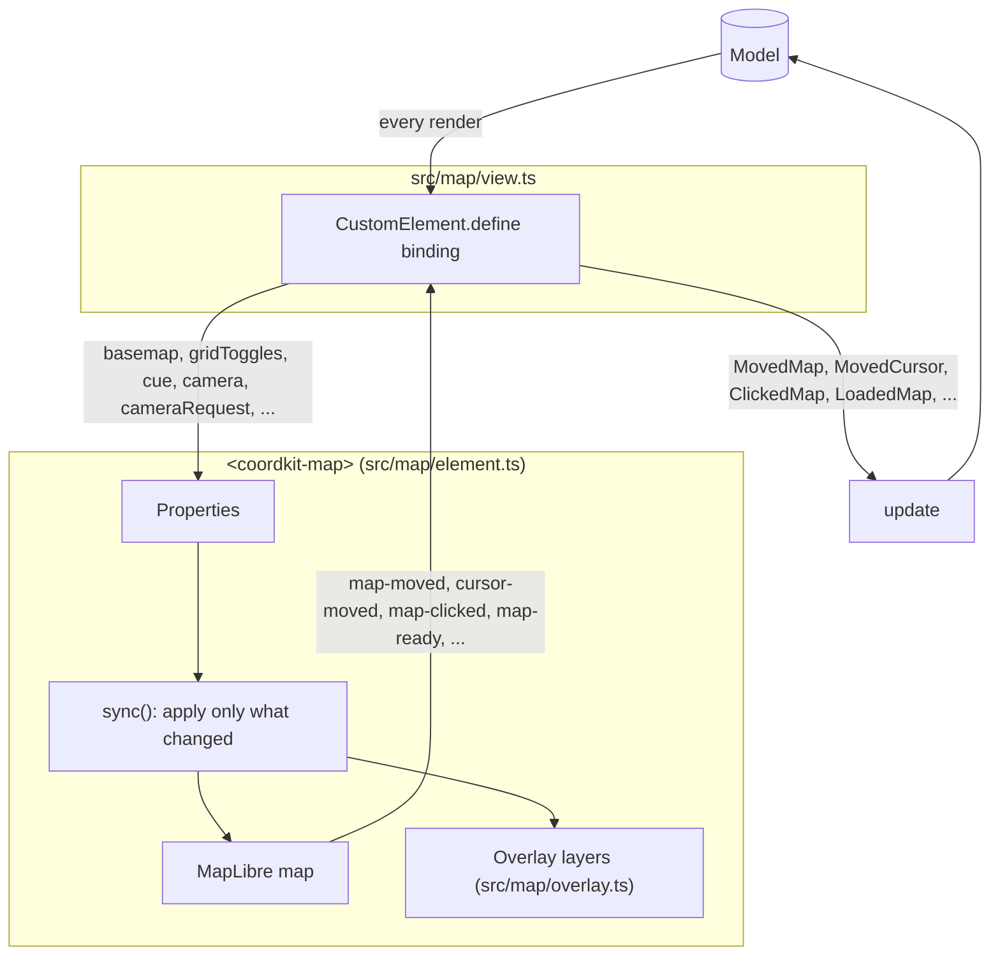

`src/map/properties.ts` declares the properties and the events one time, as
Schemas. Two parts use that record:

- The element (`src/map/element.ts`) uses it for its property accessors.
- The view (`src/map/view.ts`) gives it to `CustomElement.define`. This makes
  typed attributes, for example `map.Cue(model.maybeCue)`, and typed handlers,
  for example `map.OnMapClicked(point => Message.ClickedMap({ point }))`.

On each render the view sets every property from the Model. The element
collects the changes in a microtask, then applies only the properties that are
different from the last values it applied.

Do not add a Command that sends state into the map. Add an element property.
If a Command moves the map, DevTools time travel cannot move it back.

### Camera and camera request

The Model holds two values for the camera. They have different jobs.

| Field                | Set by                                       | What the element does                                                        |
| -------------------- | -------------------------------------------- | ---------------------------------------------------------------------------- |
| `maybeCamera`        | `MovedMap`, after each pan or zoom           | Jumps only if the property changed **and** it is different from the map view |
| `maybeCameraRequest` | The root, after a `ChoseLocation` OutMessage | Flies or fits one time for each new `id`                                     |

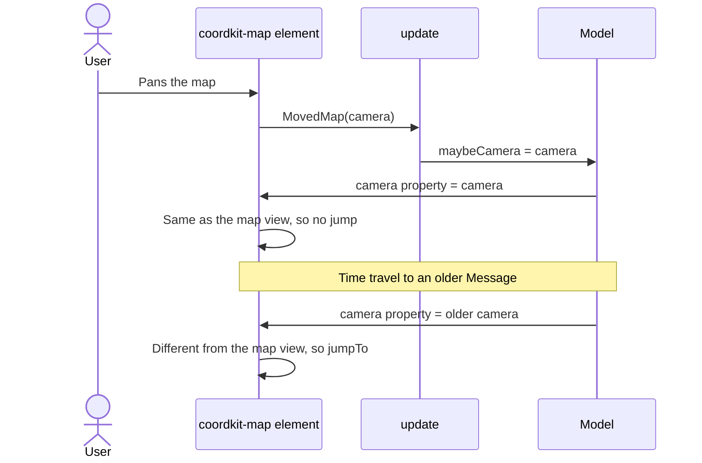

This design gives two results:

- A render during a pan does not pull the map back.
- Time travel in DevTools moves the map to the camera of that time.

## URL and saved settings

The URL and `localStorage` keep state between visits. Flags read them at the
start. Commands write them after each change. The Model is the only source of
truth.

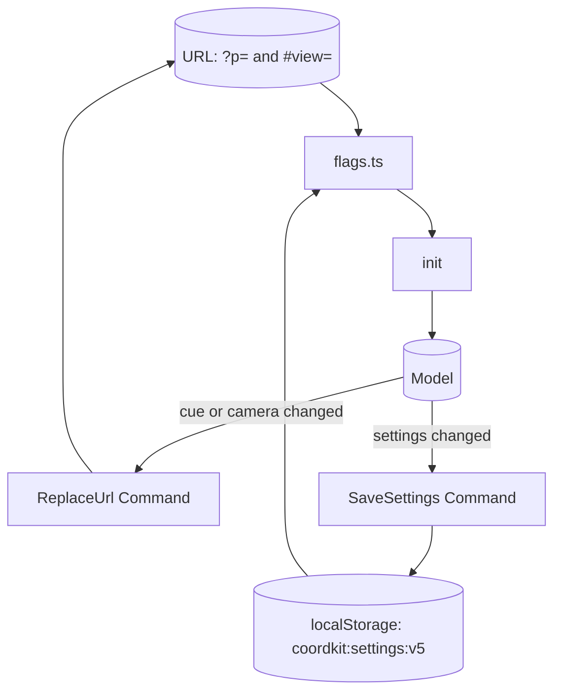

MapLibre has its own `hash` option. CoordKit turns it off, so that only the
Model writes the URL.

## DevTools and time travel

`src/app/entry.ts` turns on Foldkit DevTools. DevTools records each Message and
each Model. You can go back to an older Model, and the view renders it.

- `MovedCursor` is in `excludeFromHistory`. It occurs on each mouse movement,
  so DevTools does not record it.
- During a replay, Foldkit mutes the handlers in the view. A map that shows an
  older Model cannot send Messages to the live Model.
- Because the map is a function of the Model, the map moves with the replay.

## Tests

Because `update` and `view` are pure functions, tests can run them without a
browser.

| Kind  | Files                                                    | What it checks                                                                  |
| ----- | -------------------------------------------------------- | ------------------------------------------------------------------------------- |
| Story | `src/app/story.test.ts`, `src/submodels/*/story.test.ts` | `update` only. Give a Model and Messages, then check the Model and the Commands |
| Scene | `src/app/scene.test.ts`                                  | `update` and `view` together. Click, type and find elements by role or label    |

A story test looks like this:

```ts
story(
  update,
  given(loadingModel),
  message(Message.LoadedMap()),
  model(({ mapState }) => expect(mapState).toEqual(MapState.Ready())),
  Command.expectNone(),
)
```

The tests do not run Commands. They check which Commands `update` returns, and
they give the result Messages by hand.

## Example: the user clicks the map

This example shows all of the parts together.

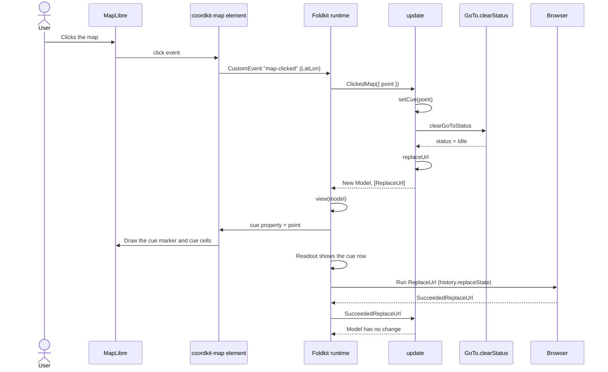

## Related documents

- [`FOLDKIT.md`](../FOLDKIT.md): the Foldkit architecture, APIs and
  conventions.
- [`AGENTS.md`](../AGENTS.md): the project layout and the rules for each
  folder.
- `repos/foldkit`: the Foldkit source. Run `just foldkit-source` to get it.
